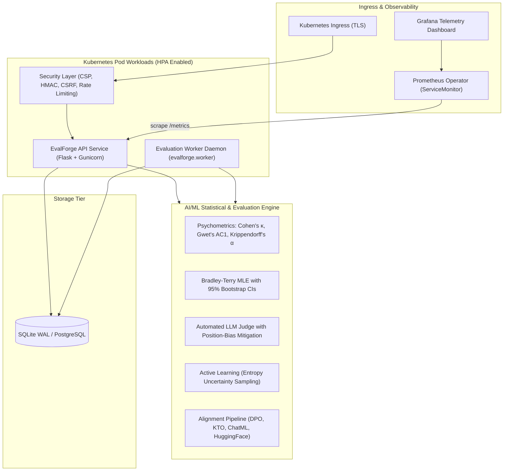
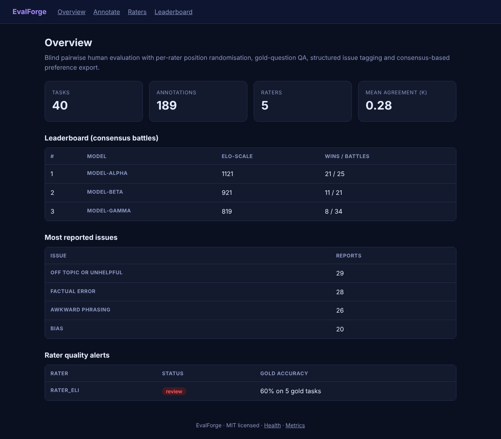
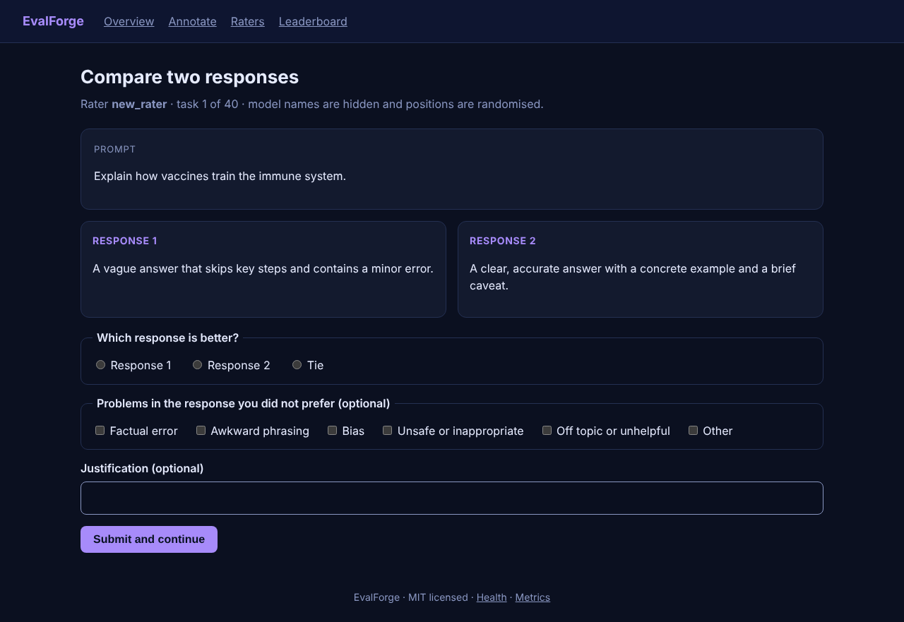
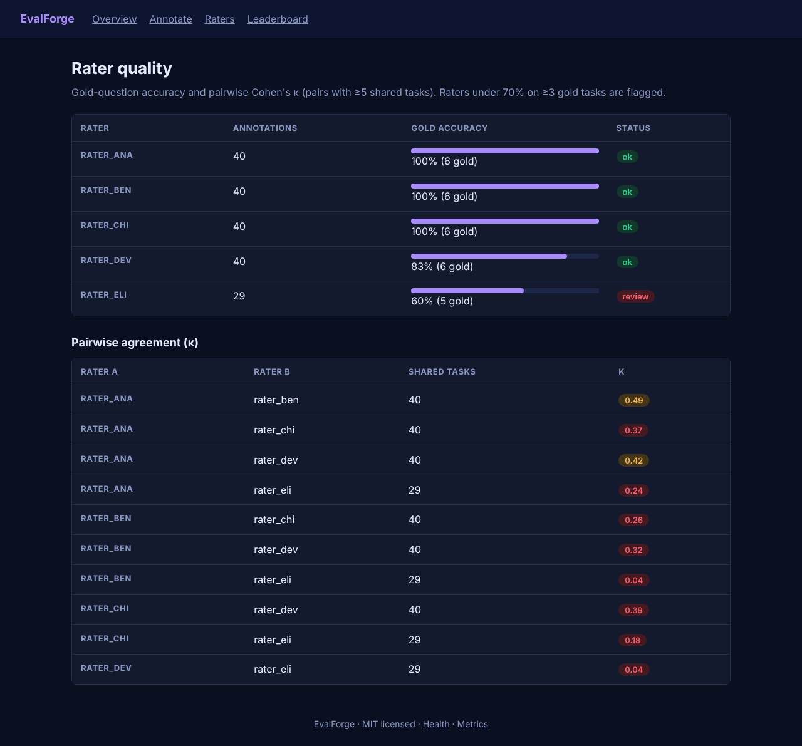
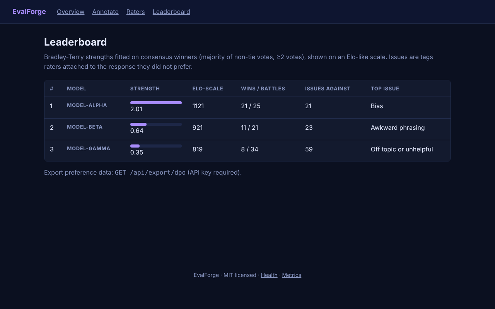
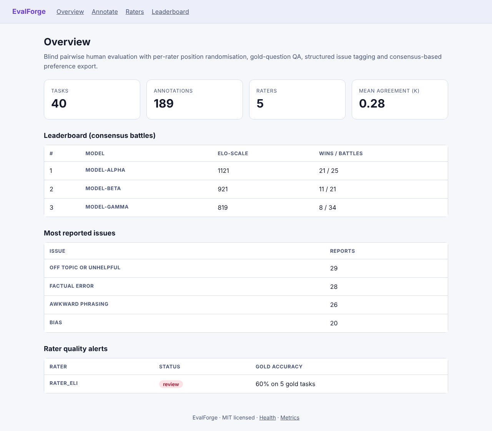
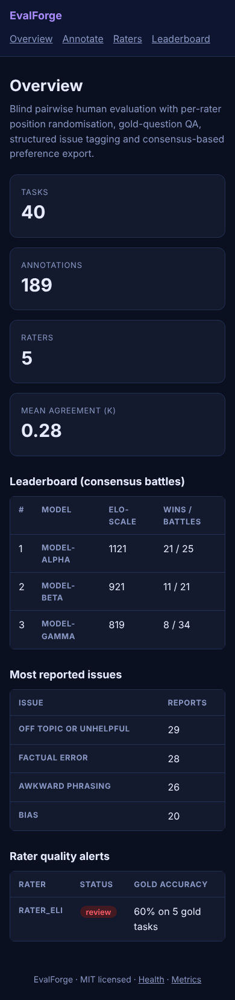

# EvalForge

> **Enterprise Human-in-the-Loop & LLM-as-a-Judge Evaluation Platform**: Blind pairwise annotation, structured issue tagging, psychometric agreement metrics (Krippendorff's α, Gwet's AC1, Cohen's κ), Bradley-Terry Elo modeling with bootstrap confidence intervals, active learning uncertainty sampling, and multi-format alignment export (DPO, KTO, ChatML, HuggingFace).

     

---

## Architecture Overview



For complete technical specifications, see [docs/ARCHITECTURE.md](docs/ARCHITECTURE.md).

---

## Key Capabilities

### 1. Heavily AI/ML & Psychometric Rigor
- **Inter-Annotator Agreement**:
  - **Krippendorff's Alpha ($\alpha$)**: Evaluates reliability across arbitrary numbers of raters and handles missing values.
  - **Gwet's $AC_1$**: Paradox-resistant statistic that remains stable even when category prevalence is heavily skewed.
  - **Cohen's Kappa ($\kappa$)**: Pairwise concordance matrix across common tasks.
- **Bradley-Terry Preference Modeling**:
  - Maximum Likelihood Estimation with Bayesian smoothing.
  - **Non-Parametric Bootstrap ($B=300$)**: Produces 95% Confidence Intervals ($[\text{Elo}_{\text{low}}, \text{Elo}_{\text{high}}]$) and standard error metrics.
  - Pairwise win probability matrix $P(\text{model}_i > \text{model}_j)$.
- **Automated LLM-as-a-Judge**:
  - Multi-criteria rubrics: *Helpfulness*, *Factual Accuracy*, *Safety & Harmlessness*, *Instruction Following*, and *Style*.
  - Chain-of-Thought (CoT) reasoning extraction.
  - **Position-Bias Mitigation**: Compares forward $(A, B)$ and reverse $(B, A)$ permutations to flag inconsistent verdicts.
- **Active Learning Queue Prioritization**:
  - Shannon entropy uncertainty sampling:
    $$H(p) = - p \log_2(p) - (1-p) \log_2(1-p), \quad p = \frac{p_i}{p_i + p_j}$$
  - Ranks unannotated and contested tasks to maximize human labeling ROI.
- **Multi-Format Dataset Export**:
  - **DPO**: Direct Preference Optimization (`prompt`, `chosen`, `rejected`).
  - **KTO**: Kahneman-Tversky Optimization (`prompt`, `completion`, `label: bool`).
  - **ChatML**: OpenAI / Anthropic conversational messages.
  - **HuggingFace**: Dataset records with rich attribution metadata.

---

### 2. Cloud-Native Kubernetes & DevOps ("Kuderkutees")
- **Production Helm 3 Chart (`deploy/helm/evalforge`)**:
  - Scalable Web API Deployment and decoupled background Worker Deployment.
  - **HorizontalPodAutoscaler (HPA)**: Automatic scaling based on CPU (75%) and Memory (80%) thresholds.
  - **Zero-Trust NetworkPolicy**: Restricts ingress to Ingress Controller and egress to CoreDNS and external HTTPS APIs.
  - **PodDisruptionBudget (PDB)**: Guarantees high availability during cluster maintenance.
  - **Prometheus Operator ServiceMonitor & PrometheusRule**: Automated scraping and custom alerting (`EvalForgeLowInterRaterAgreement`, `EvalForgeHighFlaggedRaters`).
- **Kustomize Raw Manifests (`deploy/k8s/`)**:
  - Modular base and overlays (`staging`, `production`).
- **Terraform / OpenTofu Module (`deploy/terraform/`)**:
  - Automated cloud provisioning for AWS EKS, GKE, or self-hosted Kubernetes.
- **Docker Architecture**:
  - Dual-stage hardened build with non-root UID 10001 and read-only root filesystem.
  - Complete `docker-compose.yml` stack with Web API, Background Worker, Prometheus, and Grafana.

---

### 3. CI/CD & DevSecOps Automation
- **GitHub Actions (`.github/workflows/`)**:
  - **`ci.yml`**: Python matrix testing (3.10, 3.11, 3.12), Ruff linting, Bandit SAST scanner, pip-audit vulnerability audit, and Pytest coverage (>80% floor).
  - **`docker-publish.yml`**: Multi-arch build (`linux/amd64`, `linux/arm64`) with Buildx and QEMU, automated push to GHCR (`ghcr.io/sriramkunamsetty/evalforge`), and Trivy container vulnerability scanning.
  - **`helm-ci.yml`**: Chart Testing (`ct lint`) and template verification.
  - **`codeql.yml`**: Weekly static application security analysis.

---

## Screenshots

Captured from the running application (`make screenshots`) using synthetic demo data.

**Overview: Agreement, Leaderboard, Issues, and Rater Alerts**


**Blind Pairwise Annotation with Issue Tagging**


**Rater Quality: Gold Accuracy and Pairwise Cohen's κ**


**Bradley-Terry Leaderboard with Issue Attribution**


**Light Theme**


**Mobile Viewport (390 px)**


---

## Quickstart

### Option 1: Local Development
```bash
git clone https://github.com/SriRamKunamsetty/evalforge.git && cd evalforge
python -m venv .venv && source .venv/bin/activate
pip install -r requirements-dev.txt
cp .env.example .env
make test      # Runs 51 passing unit, ML, security, and a11y tests
make run       # Starts Web API at http://localhost:8083
make worker    # Starts Background ML Worker in a separate terminal
```

### Option 2: Full Docker Compose Production Stack
Starts the Web API, Background Worker, Prometheus (9090), and pre-provisioned Grafana (3000):
```bash
docker compose up --build -d
```
Open **Grafana** at `http://localhost:3000` (User: `admin`, Password: `admin`) to monitor real-time Krippendorff's $\alpha$, rater throughput, and model win rates.

### Option 3: Kubernetes Deployment via Helm
```bash
# 1. Create production secret
kubectl create namespace evalforge
kubectl create secret generic evalforge-secrets -n evalforge \
  --from-literal=API_KEY="$(openssl rand -hex 24)" \
  --from-literal=SECRET_KEY="$(openssl rand -hex 32)"

# 2. Install Helm Chart with autoscaling & monitoring
helm install evalforge deploy/helm/evalforge -n evalforge
```

### Option 4: Kubernetes via Kustomize
```bash
kubectl apply -k deploy/k8s/overlays/production
```

---

## API & OpenAPI Specification

Interactive OpenAPI documentation is served at `/api/openapi.json`.

| Method | Path | Auth | Description |
|---|---|---|---|
| `POST` | `/api/tasks` | API key | Batch import pairwise comparison tasks (1-1000 items) |
| `GET` | `/api/stats` | none | Aggregated statistics, Krippendorff's $\alpha$, mean $\kappa$, issues |
| `GET` | `/api/v1/leaderboard/bootstrap` | none | Bradley-Terry Elo ratings with 95% Bootstrap Confidence Intervals |
| `GET` | `/api/v1/queue/prioritized` | none | Active learning uncertainty-prioritized task queue |
| `POST` | `/api/v1/judge/evaluate` | API key | Automated LLM/Heuristic judge with multi-rubric evaluation |
| `GET` | `/api/v1/export/preferences` | API key | Multi-format alignment export (`?format=dpo\|kto\|chatml\|hf`) |
| `GET` | `/healthz` | none | Kubernetes liveness and readiness probe |
| `GET` | `/metrics` | none | Prometheus-compatible metrics exposition |

---

## Security & Defense in Depth
- **Zero-Trust Input Processing**: Parameterized SQL, strict type validation, and 100% Jinja auto-escaping.
- **Strict Content Security Policy (CSP)**: Completely disallows `'unsafe-inline'` styles and scripts.
- **Constant-Time Verification**: Prevents timing attacks on `X-API-Key` and CSRF tokens (`hmac.compare_digest`).
- **Memory-Bounded Rate Limiting**: Capped client registry with sliding 60-second window.
- **Container Hardening**: Non-root UID 10001, read-only root filesystem, dropped Linux capabilities (`cap_drop: ALL`), and no privilege escalation.

---

## Testing & Quality Assurance

```bash
make test
```
**51 Automated Tests**:
- `tests/test_evalforge.py`: Core algorithms, API workflows, CSRF, XSS/SQLi injection immunity.
- `tests/test_ml.py`: Krippendorff's $\alpha$, Gwet's $AC_1$, bootstrap confidence intervals, active learning sampling, heuristic judge, dataset serialization.
- `tests/test_security.py`: Constant-time checks, rate limiter memory bounding, secret key persistence, proxy trust headers.
- `tests/test_accessibility.py`: WCAG 2.1 AA mathematical contrast ratios ($\ge 4.5:1$) across dark/light themes, keyboard navigation, and landmark semantics.

---

## Contributing

See [CONTRIBUTING.md](CONTRIBUTING.md) and [CONTRIBUTORS.md](CONTRIBUTORS.md).

## License

MIT License. Copyright (c) 2026 SriRam Kunamsetty (mohansriramkunamsetty@gmail.com).
