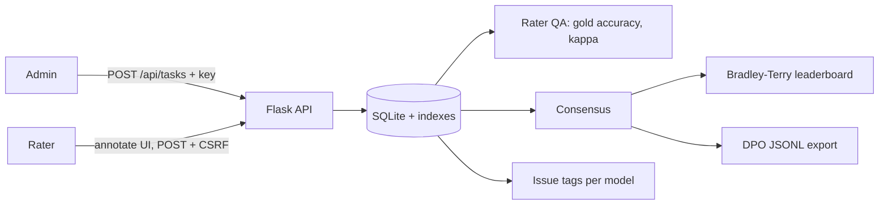

# EvalForge

> Human-in-the-loop LLM evaluation: blind pairwise annotation, structured issue tagging, rater quality control, Bradley-Terry leaderboards and DPO export.

    

## Problem statement

Good preference data needs more than clicks. Raters drift, position bias creeps in, noisy annotators poison datasets, and a bare 'A beats B' hides *why*. EvalForge builds quality control and structured feedback (factual errors, awkward phrasing, bias, unsafe content) into the workflow so the data, and the model comparison, can be trusted.

## Features

- **Blind pairwise annotation:** model names hidden, **per-(task, rater) deterministic position randomisation** to cancel position bias.
- **Structured feedback:** issue tags (factual error, awkward phrasing, bias, unsafe/inappropriate, off-topic, other) attached to the response the rater did not prefer, plus an optional justification. Issues are attributed to models on the leaderboard.
- **Rater QA:** gold-question accuracy with automatic flagging (<70% on ≥3 gold tasks) and pairwise **Cohen's κ**.
- **Consensus:** majority of non-tie votes (≥2) decides a battle; **Bradley-Terry** strengths on an Elo-like scale.
- **DPO export** (`prompt`/`chosen`/`rejected` JSONL) from consensus tasks only.
- CSRF-protected forms, POST-only state changes, REST API, Prometheus metrics, Helm chart.

## Screenshots

Captured from the real running app (`make screenshots`) using **synthetic demo data**.

**Overview: agreement, leaderboard, issues and rater alerts**


**Blind annotation with issue tags (labelled form, keyboard friendly)**


**Rater quality: gold accuracy and pairwise Cohen's κ**


**Bradley-Terry leaderboard with issues per model**


**Light theme**


**Mobile layout (390 px wide)**


## Architecture



## Quickstart

```bash
git clone https://github.com/SriRamKunamsetty/evalforge.git && cd evalforge
python -m venv .venv && . .venv/bin/activate && pip install -r requirements-dev.txt
cp .env.example .env            # then edit API_KEY and SECRET_KEY
make test                       # 35 tests: unit, API, security, accessibility
make run                        # http://localhost:8083
```

**Docker** (non-root, read-only filesystem, all capabilities dropped):

```bash
export API_KEY=$(openssl rand -hex 24) SECRET_KEY=$(openssl rand -hex 32)
docker compose up --build       # http://localhost:8083
```

**Kubernetes** (single replica because of SQLite; ClusterIP Service):

```bash
kubectl create secret generic evalforge-secrets --from-literal=API_KEY="$API_KEY" --from-literal=SECRET_KEY="$SECRET_KEY"
helm install evalforge deploy/helm/evalforge --set image.repository=ghcr.io/sriramkunamsetty/evalforge
```

## API reference

| Method | Path | Auth | Description |
|---|---|---|---|
| `POST` | `/api/tasks` | API key | JSON list (1-1000) of `{prompt, model_a, response_a, model_b, response_b, gold?}`; `gold` ∈ `a`/`b` marks a gold question |
| `GET` | `/api/stats` | none | Counts, per-rater QA, mean κ, leaderboard, issue counts |
| `GET` | `/api/export/dpo` | API key | Consensus preferences as JSONL |
| `GET` / `POST` | `/annotate` | session + CSRF | Annotation workflow |
| `POST` | `/session`, `/session/end` | CSRF | Set / clear the rater name |
| `GET` | `/`, `/raters`, `/leaderboard` | none | UI pages |
| `GET` | `/healthz`, `/metrics` | none | Health and Prometheus metrics |

## Configuration

| Variable | Default | Purpose |
|---|---|---|
| `API_KEY` | *(unset)* | Required for write endpoints. **If unset, writes return 503** (secure by default) |
| `SECRET_KEY` | auto-generated, stored in `DATA_DIR/.secret_key` (mode 0600) | Signs session cookies; auto-file is shared by all workers and survives restarts |
| `DATA_DIR` | `./data` (`/data` in Docker) | Where the SQLite database lives |
| `RATE_LIMIT_PER_MIN` | `120` | Per-IP request limit (per worker process) |
| `TRUST_PROXY` | `0` | Set `1` only behind a proxy you control, so the rate limiter uses `X-Forwarded-For` |
| `COOKIE_SECURE` | `0` | Set `1` behind HTTPS: `Secure` cookies and HSTS header |

## Security

**Implemented and covered by tests**

- Write endpoints are disabled unless `API_KEY` is set; constant-time comparison that also handles non-ASCII input (no 500s).
- Parameterised SQL only (injection payload test); Jinja autoescaping (XSS test); **strict CSP without `unsafe-inline`**, `X-Frame-Options: DENY`, `nosniff`, `no-referrer`, `no-store` on pages (static assets are cacheable), HSTS when `COOKIE_SECURE=1`.
- Request-size limits (413), validation on every endpoint, per-IP rate limiting (429) with **bounded memory**, generic error pages (no stack traces), failed-auth logging.
- Session cookies `HttpOnly`, `SameSite=Lax`, `Secure` when enabled; secret key persisted with mode 0600 and shared across workers.
- Every state change is a CSRF-protected POST (including choosing a rater); a test proves GET never alters the session. Rater names must match `^[A-Za-z0-9_.-]{1,40}$`.
- Rater identity is a self-declared name (no login): put SSO in front for real deployments.
- Container: non-root UID 10001, read-only root FS, `cap_drop: ALL`, `no-new-privileges`; Helm chart adds `seccompProfile: RuntimeDefault`.
- CI: Trivy image scan (fails on HIGH/CRITICAL), CodeQL, Dependabot, ruff, container smoke test.

**Known limitations**

- Read-only pages and `/metrics` are unauthenticated: use an authenticating ingress/proxy or keep the Service cluster-internal.
- SQLite means one replica; rate limiting is in-memory per worker. TLS is terminated outside the app. See [SECURITY.md](SECURITY.md).
- Analytics are held in memory per worker: fine for tens of thousands of annotations, not millions.
- Issue tags are per annotation (not per sentence).

## Accessibility

- Semantic landmarks (`header`, `nav`, `main`, `footer`), a **skip link**, exactly one `h1` per page with no skipped heading levels, and **unique, state-aware page titles**.
- Every table has a caption and `scope`d headers; scrollable tables are focusable regions; progress is shown with `<progress>` plus visible text (not colour alone).
- Forms use real `<label>`s, `fieldset`/`legend` groups and native controls, so they are fully **keyboard operable**; visible focus rings.
- **No JavaScript required**; works in text-heavy, low-bandwidth and assistive-technology environments. No inline styles, so the strict CSP also holds.
- Light and dark themes follow the OS preference; **WCAG AA contrast (≥4.5:1) is asserted by an automated test for both themes**; responsive down to 390 px.
- These are automated structural checks. A manual screen-reader pass (NVDA/VoiceOver) and an axe audit are still recommended before a production launch.

## Efficiency

- Analytics (agreement, gold QA, consensus, leaderboard, issue counts) are computed once and **cached until tasks or annotations change** (tested: five pages and the metrics endpoint, one computation).
- Next-task lookup is index-backed; position randomisation is O(1); Bradley-Terry cost scales with the number of model pairs, not annotations.
- Rate-limiter state is bounded (10,000 clients); static assets are cached for an hour; all SQL is indexed or O(1) per row.

## Testing

`35` tests: `make test` or `python -m unittest discover -s tests`. They cover core logic, the HTTP API, auth edge cases, validation, security headers, XSS/SQL-injection, rate limiting, error paths, robustness against malformed input, caching behaviour and accessibility (structure plus contrast). Line coverage measured with the stdlib `trace` module is about 95-97%; CI enforces a 75% floor with `coverage.py` on Python 3.10 and 3.12. Code is split into a pure, framework-free `core.py` (fast unit tests) and a thin Flask layer; `create_app(db_path, config)` makes every test hermetic.

| Verified during development | Written but not executed yet |
|---|---|
| Full test suite, real-browser screenshots, lint-style AST check (no unused imports, no ambiguous names) | GitHub Actions, `docker build`/Trivy, `helm lint`, cluster deployment |

## How this maps to common review criteria

| Criterion | Evidence |
|---|---|
| **Code quality** | Pure core + thin web layer, type hints, docstrings, single-responsibility helpers, no unused imports, shared security module with documented behaviour |
| **Security** | Section above: secure-by-default writes, CSP without inline, bounded rate limiter, hardened parsing, container and CI scanning |
| **Efficiency** | Section above: measured/tested concurrency, SQL aggregates, caching, bounded inputs and memory |
| **Testing** | 35 tests incl. security, robustness and accessibility suites; hermetic app factory; coverage floor in CI |
| **Accessibility** | Section above: landmarks, labels, captions, contrast tests, keyboard and no-JS operation, responsive themes |
| **Problem alignment** | Targets the job-to-be-done of AI evaluators: compare responses, identify concrete problems (factual errors, awkward phrasing, bias, inappropriate output), justify the judgement, and produce structured, quality-controlled feedback that is usable for model improvement. |

## Project structure

```
evalforge/
  core.py      kappa, gold QA, consensus, position swap, Bradley-Terry, DPO
  server.py    Flask app, SQLite, cached analytics, UI + API
  security.py  headers, rate limit, API key, CSRF, secrets
  templates/ static/
tests/         core, API/workflow, security, accessibility
scripts/ deploy/helm/
Dockerfile docker-compose.yml .github/workflows/
```

## Roadmap

- Rater accounts / SSO and per-project workspaces.
- Krippendorff's α, confidence intervals on the leaderboard, adjudication queue for split votes.
- Multi-criteria rubrics (Likert per helpfulness / accuracy / tone / safety) and Postgres backend.

## Contributing

See [CONTRIBUTING.md](CONTRIBUTING.md) and [CONTRIBUTORS.md](CONTRIBUTORS.md). Issues and PRs welcome.

## License

MIT, see [LICENSE](LICENSE).
