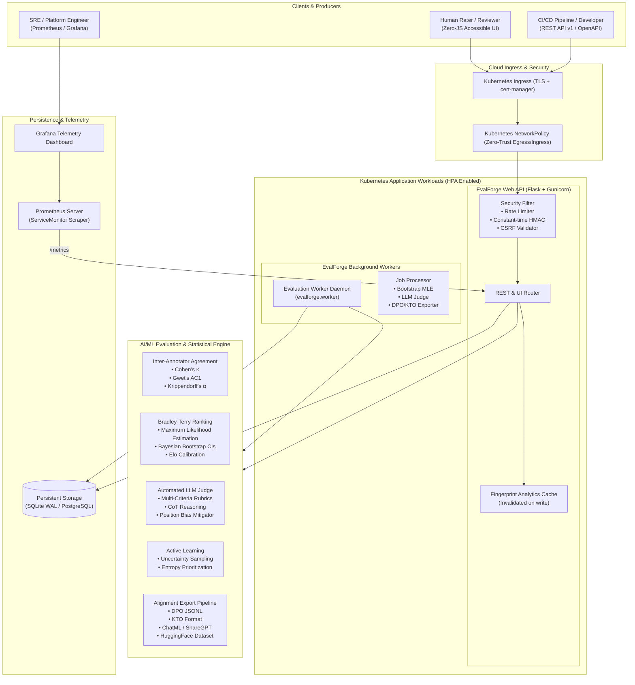

# EvalForge Enterprise System Architecture

EvalForge is a production-grade, human-in-the-loop and automated LLM evaluation platform designed for testing, benchmarking, and aligning Large Language Models.

---

## 1. System Architecture Diagram

---

## 2. Advanced AI/ML Statistical Formulations

### A. Krippendorff's Alpha ($\alpha$) for Reliability
Unlike simple pairwise concordance, Krippendorff's Alpha handles arbitrary numbers of raters and missing data across units $u$:
$$\alpha = 1 - \frac{D_o}{D_e}$$
where $D_o$ is the observed disagreement and $D_e$ is the disagreement expected by chance across all coincidence pairs.

### B. Gwet's $AC_1$ Paradox-Resistant Concordance
To circumvent Cohen's Kappa paradox (where high observed agreement on a skewed category paradoxically deflates $\kappa$), Gwet's $AC_1$ calculates expected chance agreement based on marginal propensity:
$$AC_1 = \frac{p_o - p_e(\gamma)}{1 - p_e(\gamma)}$$

### C. Bradley-Terry Latent Skill Modeling with Bootstrap Confidence Intervals
Pairs of candidate model completions $(i, j)$ are modeled as:
$$P(i > j) = \frac{p_i}{p_i + p_j}$$
- **Iterative Maximum Likelihood Estimation**:
  $$p_i^{(t+1)} = \frac{W_i}{\sum_{j} \frac{N_{ij}}{p_i^{(t)} + p_j^{(t)}}}$$
  with Bayesian smoothing ($W_i = \text{wins}_i + 0.5$).
- **Non-Parametric Bootstrap Resampling**: Evaluates $B=300$ resampled subsets to output $95\%$ Confidence Intervals $[\text{Elo}_{\text{low}}, \text{Elo}_{\text{high}}]$ and standard deviations $\sigma_{\text{Elo}}$ for model ranking certainty.

### D. Active Learning via Binary Uncertainty Sampling
Human labeling budgets are maximized by sorting pending tasks by their Shannon entropy under current model ratings:
$$H(p) = - p \log_2(p) - (1-p) \log_2(1-p), \quad p = \frac{p_i}{p_i + p_j}$$
Pairs where $p \approx 0.5$ (maximum contestation or closest ability) receive highest acquisition priority.

---

## 3. Cloud-Native & Kubernetes Infrastructure ("Kuderkutees")

### Component Architecture
1. **API Web Service (`deploy/helm/evalforge/templates/deployment.yaml`)**:
   - Autoscaled via `HorizontalPodAutoscaler` from 2 to 10 replicas.
   - Resource bounded: requests 200m CPU / 256Mi RAM; limits 1000m CPU / 512Mi RAM.
   - Hardened `SecurityContext`: non-root (UID 10001), read-only root filesystem, drop `ALL` capabilities, `seccompProfile: RuntimeDefault`.
2. **Background ML Worker (`deploy/helm/evalforge/templates/worker-deployment.yaml`)**:
   - Decoupled worker tier executing asynchronous bootstrapping, batch evaluations, and dataset transformation.
3. **High-Availability & Policy Controls**:
   - `PodDisruptionBudget`: ensures `minAvailable: 1` during node maintenance or upgrades.
   - `NetworkPolicy`: ingress restricted to Ingress Controller and Prometheus; egress restricted to CoreDNS and external HTTPS model APIs.
   - `ServiceMonitor`: native Prometheus Operator integration with custom `PrometheusRule` alerts.

---

## 4. Production CI/CD & DevSecOps Strategy

| Stage | Tooling | Purpose |
|:---|:---|:---|
| **Lint & Static Analysis** | Ruff | Enforces PEP 8 style, line-length 110, import ordering |
| **SAST Security Scan** | Bandit | Identifies common Python vulnerabilities (CWE, SQL injection, insecure cryptography) |
| **Unit & Integration Test** | Pytest + Coverage | Enforces 80%+ line coverage floor across Python 3.10, 3.11, 3.12 |
| **Container Image Build** | Docker Buildx / QEMU | Compiles multi-platform images (`linux/amd64`, `linux/arm64`) |
| **Container Vulnerability Scan** | Trivy | Fails build on `CRITICAL` or `HIGH` Common Vulnerabilities and Exposures (CVEs) |
| **Kubernetes Validation** | Helm Lint & Template | Validates YAML syntax, Kubernetes API schemas, and Helm chart packaging |
| **Registry Publication** | GitHub Container Registry | Publishes verified images to `ghcr.io/sriramkunamsetty/evalforge` |
